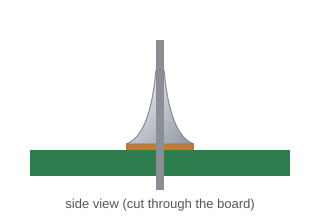
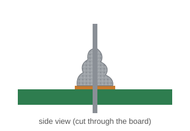
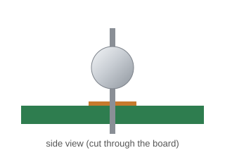
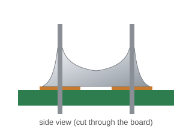
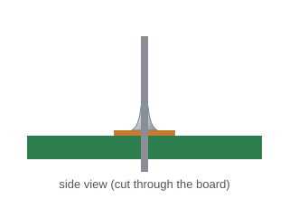
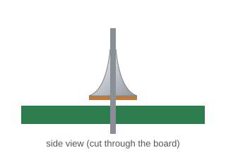

# Soldering: Good vs. Bad Joints

## A good joint

{ width="420" }

- **Shiny and smooth**
- **Cone- or volcano-shaped,** wrapping the lead
- **Covers the pad** completely
- **Doesn't touch** any neighboring pads

## Common problems

<figure markdown>

<figcaption>Cold joint</figcaption>
</figure>

<figure markdown>

<figcaption>Blob</figcaption>
</figure>

<figure markdown>

<figcaption>Bridge</figcaption>
</figure>

<figure markdown>

<figcaption>Starved joint</figcaption>
</figure>

<figure markdown>

<figcaption>Lifted pad</figcaption>
</figure>

| What you see | What it's called | Likely cause | Fix |
|---|---|---|---|
| Dull, grainy, or lumpy | **Cold joint** | Moved while cooling, or not hot enough | Add flux and reheat until it flows |
| A ball sitting on top | **Blob** | Solder melted on the tip, or the pad wasn't heated | Heat pad + lead first, then feed solder |
| Solder connects two pads | **Bridge** | Too much solder | Reheat and drag the iron away; ask about solder wick |
| Not enough to cover the pad | **Starved joint** | Too little solder | Add flux and a little more solder |
| Pad peeled up | **Lifted pad** | Heated too long | Stop and ask the instructor |
| Solder won't melt | — | Tip oxidized or not tinned | Clean on the sponge, then re-tin |

[Next: Check Your Knowledge :material-arrow-right:](check-your-knowledge.md){ .md-button .md-button--primary }

