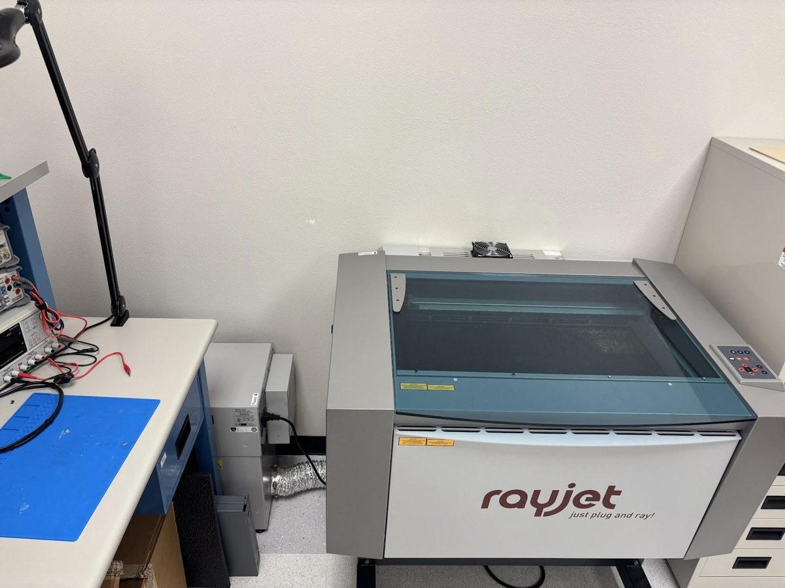
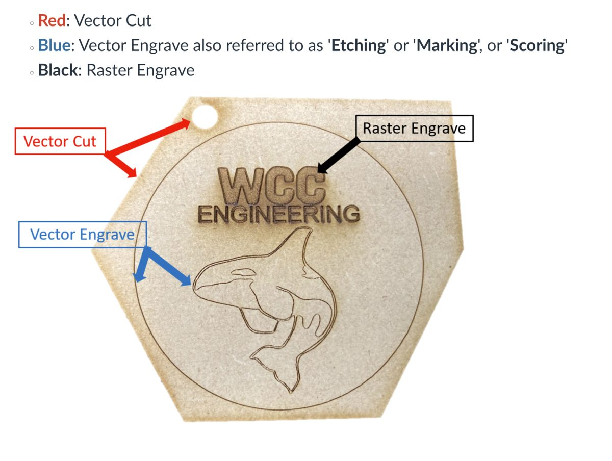

# Laser Cutting: Overview & Safety

The laser cutter available for student use is in the WCC Engineering Lab, **CAS 117**. It's a **TROTEC Rayjet 300**, a CO₂ laser with a bed size of **29" × 17"**.

!!! question "Before you laser cut…"
    Have you completed a **drawing of your design** in Onshape? It's required to use the laser cutter.
    **If not, go do that before taking up the CAS 117 computer.**

## How a laser cutter works

A **CO₂ laser tube** makes an invisible infrared beam. **Mirrors** bounce it to the cutting head, where a **lens** focuses it to a tiny, very hot spot. The material **burns or vaporizes** along the path, and the **ventilation fan** pulls the smoke out.

It's a *subtractive* process: it removes material, unlike a 3D printer, which adds it.

## Cut, etch, or engrave?

The laser doesn't know what you intend. It decides what to do from the **color of each line** in your file.

| Color | Process | What it does |
|---|---|---|
| :red_circle: **Red** | Vector Cut | Cuts all the way through |
| :large_blue_circle: **Blue** | Vector Engrave (also called *Etching*, *Marking*, or *Scoring*) | Marks a line on the surface |
| :black_circle: **Black** | Raster Engrave | Fills in an area, like text or a logo |

The laser engraves first and cuts last, so parts don't shift before the engraving is done.

## What can go in the laser?

=== "OK with approval"

    - Plywood (thin, laser-grade)
    - MDF
    - Cast acrylic
    - Cardboard, chipboard, paper
    - Natural leather, cork, felt

=== "NEVER"

    - **PVC / vinyl:** releases chlorine gas
    - **Polycarbonate (Lexan):** catches fire, doesn't cut cleanly
    - **ABS, HDPE:** melt and catch fire
    - **Fiberglass, coated carbon fiber**
    - **Metal:** reflects the beam, won't cut
    - **Anything you can't identify.** No ID, no cut.

## Safety

!!! danger "Fire is the #1 risk"
    Small flames at the cut point are normal. A flame that **keeps burning after the head moves on** is not.
    **Never walk away from a running laser.** If something catches fire: press pause, keep the lid closed, and get the instructor.

- **Ventilation fan always on.** No fan, no laser.
- **Lid stays closed.** The beam is invisible. Never open the lid or reach in mid-job.
- **Know where things are:** fire extinguisher, the pause button, and who to tell.

## Design tips for laser cutting

- **Think in flat parts.** Build 3D shapes by slotting flat parts together (tab & slot, finger joints).
- **Measure your sheet with calipers.** "1/8 in" plywood is rarely exactly 3.175 mm.
- **Account for kerf.** The beam burns away about 0.2 mm, so slots come out a little loose.
- **Leave 2–3 mm between parts.**
- **Keep features at least as thick as the sheet.**
- **Watch for islands.** The middle of an "O" falls out when cut. Engrave text instead.

**Next:** [Prepare the Machine →](prepare-machine.md)
