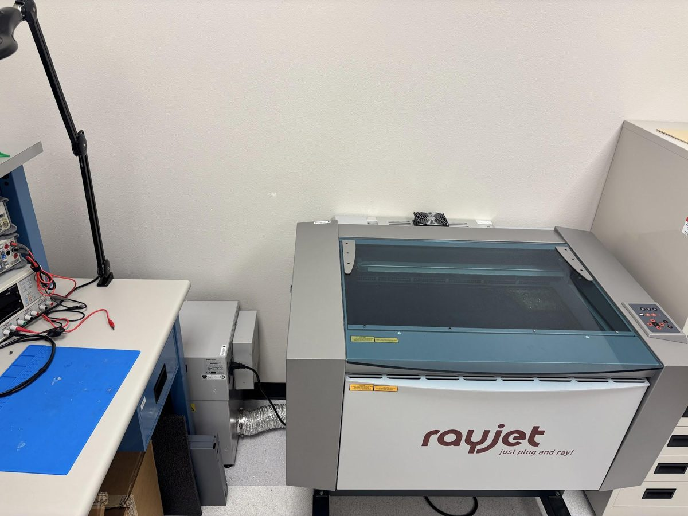
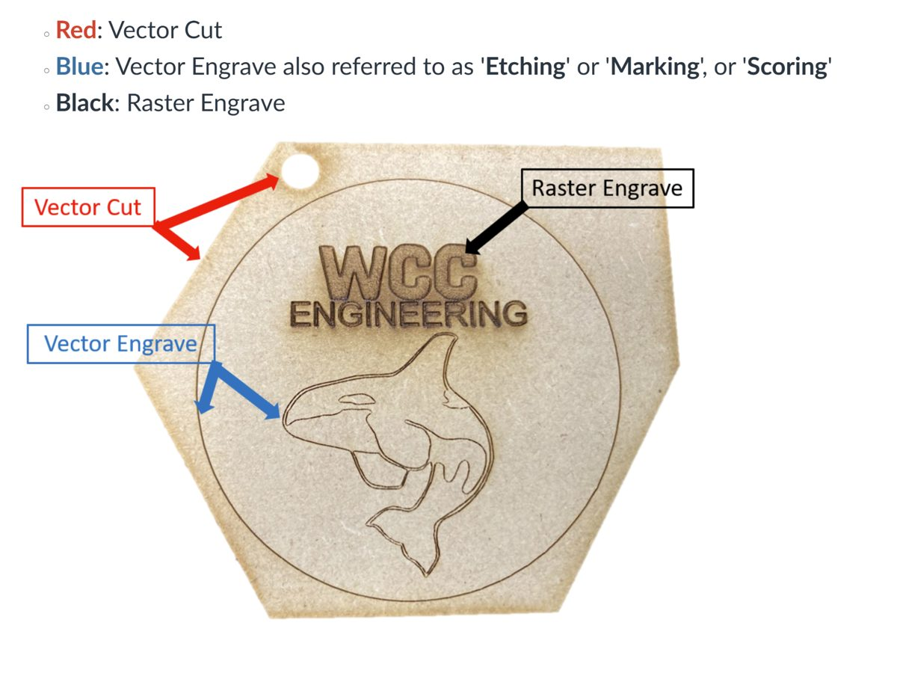
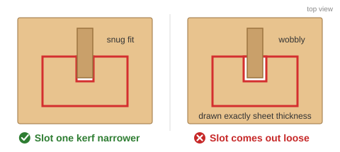
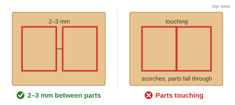
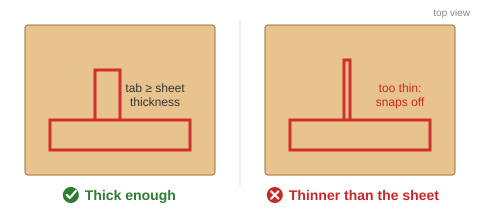
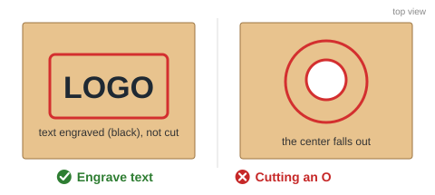

# Laser Cutting: Overview & Safety

[:material-arrow-left: Back to Home](../index.md){ .md-button }

**New to the lab?** Read the [Lab Rules](../lab-rules.md) first. They apply to every machine.

The laser cutter available for student use is in the WCC Engineering Lab, **CAS 117**. It's a **TROTEC Rayjet 300**, a CO₂ laser with a bed size of **29" × 17"**.

!!! warning "Before you come to the laser cutter"
    You need a **finished laser cut drawing** in Onshape **before** you sit down at the CAS 117 computer:

    - A **blank sheet**: no border, no title block, no dimensions
    - One **1:1 view of each part** you want cut
    - Ready to **export as a DXF**

    **Don't use the CAS 117 computer to model.** Someone else may be waiting to cut. See [Drawings & Export](../onshape/drawings-and-export.md).

!!! info "Need a computer?"
    Engineering laptops are available for anyone to use in **Cascade, room 112**.

## What is laser cutting?

A laser cutter uses a focused beam of light to **cut or engrave flat sheets** of material, like plywood, acrylic, and cardboard. You give it a 2D drawing, and it follows the lines.

### How it works

A **CO₂ laser tube** makes an invisible infrared beam. **Mirrors** bounce it to the cutting head, where a **lens** focuses it to a tiny, very hot spot. The material **burns or vaporizes** along the path, and the **ventilation fan** pulls the smoke out.

It's a *subtractive* process: it removes material, unlike a 3D printer, which adds it.

!!! info "The laser only cuts straight down"
    The beam always points **straight down** through the material. Every cut edge comes out **vertical (90° to the sheet)**.
    The laser **can't** cut angles, bevels, or chamfers through the thickness, and it can't cut a 3D shape. It cuts a flat outline, like a cookie cutter.
    Need an angled or 3D part? Build it from flat parts that slot together, or 3D print it instead.

!!! video-soon "Video coming soon"
    A video of our laser cutter cutting plywood, so you can see the beam cut straight down.

## The process: from Onshape to the laser

Every laser job follows the same path through three programs:

Before lab · any computer (engineering laptops in Cascade 112)

<ol class="flow__steps">
<li>OnshapeMake your part</li>
<li>OnshapeMake a <strong>laser cut drawing</strong>: outlines only, 1:1</li>
<li>OnshapeDownload it as a <strong>DXF</strong></li>
</ol>

At the laser · CAS 117 computer

<ol class="flow__steps" style="--flow-start: 3">
<li>CorelDRAWOpen your DXF</li>
<li>CorelDRAW<strong>Change line colors</strong> to cut or engrave</li>
<li>CorelDRAW → Rayjet Manager<strong>File → Print</strong> sends your design to Rayjet Manager</li>
<li>Rayjet Manager → LaserSend the job to the laser and press <strong>START</strong></li>
</ol>

The [Prepare Your Design](prepare-design.md) page walks through each step.

!!! tip "Just engraving text or a picture?"
    You **don't need Onshape**. You can do it all in CorelDRAW. See [How to Engrave](engrave.md).

## Cut, etch, or engrave?

The laser doesn't know what you intend. It decides what to do from the **color of each line** in your file.

| Color | Process | What it does |
|---|---|---|
| :red_circle: **Red** | Vector Cut | Cuts all the way through |
| :blue_circle: **Blue** | Vector Engrave (also called *Etching*, *Marking*, or *Scoring*) | Marks a line on the surface |
| :black_circle: **Black** | Raster Engrave | Fills in an area, like text or a logo |

The laser engraves first and cuts last, so parts don't shift before the engraving is done.

## What can go in the laser?

=== "OK with approval"

    - Plywood (thin, laser-grade)
    - MDF
    - Cast acrylic
    - Cardboard, chipboard, paper
    - Natural leather, cork, felt

=== "NEVER"

    - **PVC / vinyl:** releases chlorine gas
    - **Polycarbonate (Lexan):** catches fire, doesn't cut cleanly
    - **ABS, HDPE:** melt and catch fire
    - **Fiberglass, coated carbon fiber**
    - **Metal:** reflects the beam, won't cut
    - **Anything you can't identify.** No ID, no cut.

## Safety

!!! danger "Fire is the #1 risk"
    Small flames at the cut point are normal. A flame that **keeps burning after the head moves on** is not.
    **Never walk away from a running laser.** If something catches fire: press pause, keep the lid closed, and get the instructor.

- **Ventilation fan always on.** No fan, no laser.
- **Lid stays closed.** The beam is invisible. Never open the lid or reach in mid-job.
- **Know where things are:** fire extinguisher, the pause button, and who to tell.

## Design tips for laser cutting

- **Think in flat parts.** Build 3D shapes by slotting flat parts together (tab & slot, finger joints).
- **Measure your sheet with calipers.** "1/8 in" plywood is rarely exactly 3.175 mm.
- **Account for kerf.** The beam burns away about 0.2 mm, so slots come out a little loose.
- **Leave 2–3 mm between parts.**
- **Keep features at least as thick as the sheet.**
- **Watch for islands.** The middle of an "O" falls out when cut. Engrave text instead.

!!! warning "Don't use Transform to scale a laser-cut design"
    Want your design bigger or smaller? **Don't use Onshape's Transform (scale) feature.** Scaling shrinks or grows **every** dimension, including the slots and tabs that are sized to your material's thickness.
    Your sheet doesn't get thinner or thicker, so the scaled slots won't match it and the parts **won't fit together**.

    **Instead:** change the sizes in your sketches, and keep slot and tab widths equal to your sheet thickness. A `#thickness` variable makes this easy (see [Sketch to Part](../onshape/sketch-to-part.md#step-5-edit-later)). The same goes for resizing your design in CorelDRAW.

### See the difference

!!! quiz "Required: Now take the safety quiz in Canvas"
    Done reviewing this page? [Go to Canvas](https://wcc.instructure.com/courses/2771437) and take the **Laser Cutting Badge: Safety Quiz**. You need **100%** to pass, and you can retake it as many times as you need. You must pass it before you use the equipment.

    [:material-open-in-new: Take the quiz in Canvas](https://wcc.instructure.com/courses/2771437){ .md-button }

**Next:** [Prepare Your Design →](prepare-design.md)
