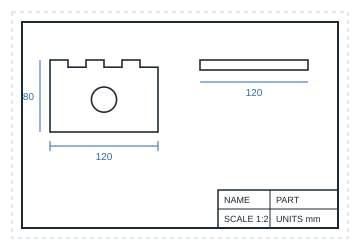
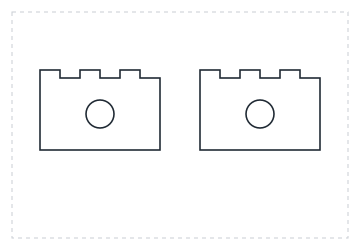
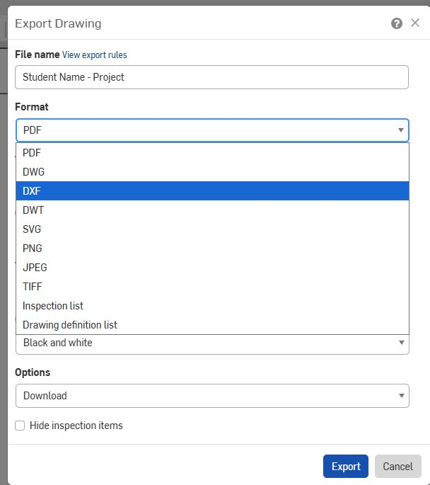
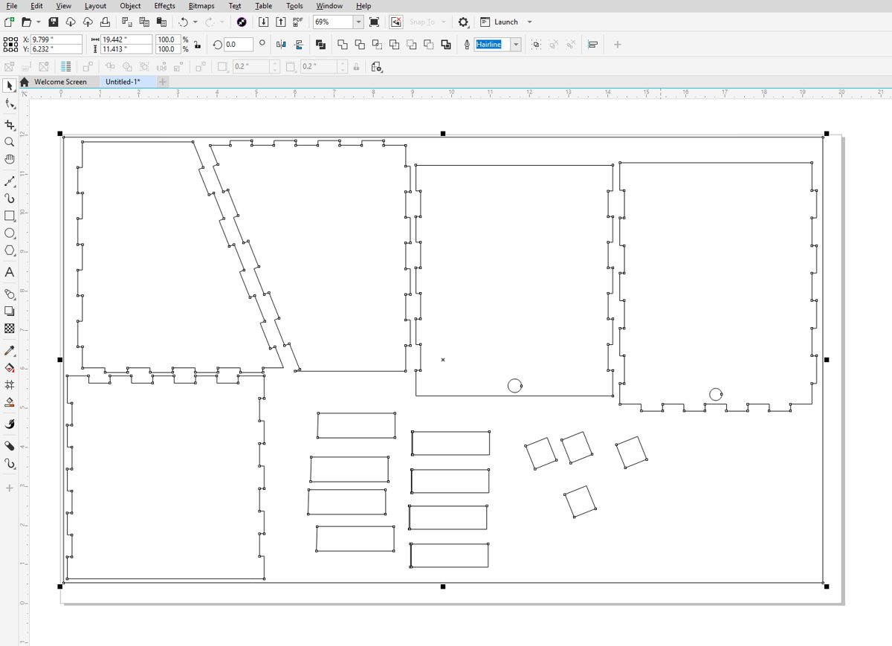
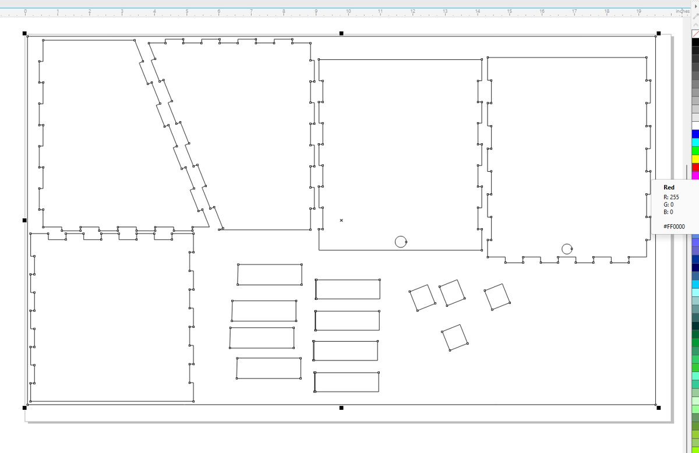
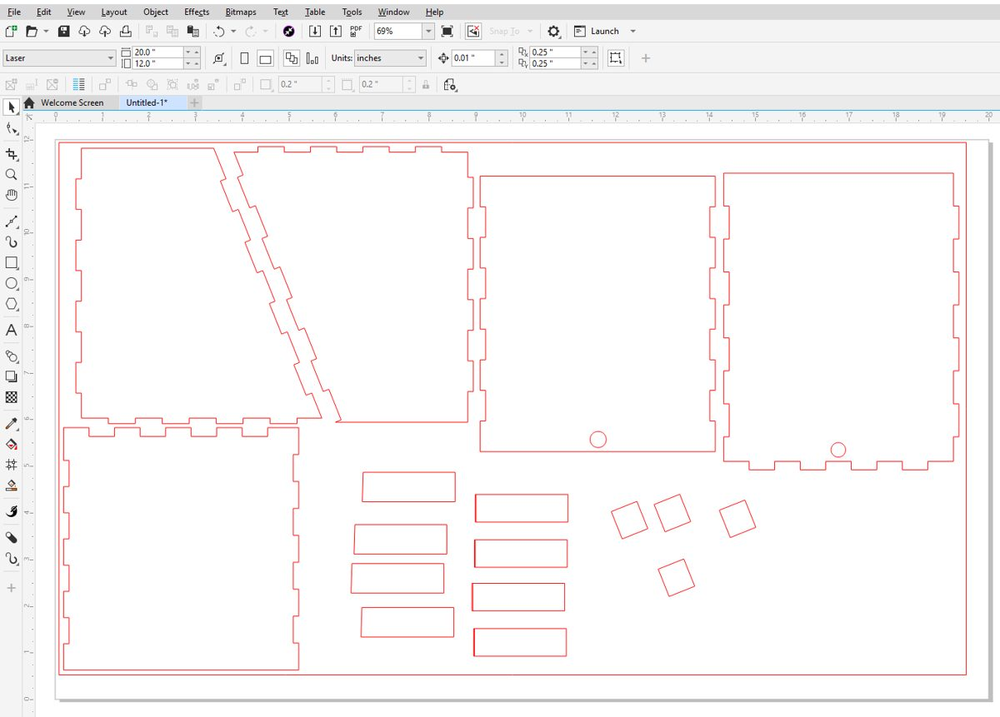

# Laser Cutting: Prepare Your Design

Your design goes through **three programs** on its way to the laser:

*Just engraving text or a picture? Skip Onshape and see [How to Engrave](engrave.md).*

Before lab · any computer (engineering laptops in Cascade 112)

<ol class="flow__steps">
<li>OnshapeMake your part</li>
<li>OnshapeMake a <strong>laser cut drawing</strong>: outlines only, 1:1</li>
<li>OnshapeDownload it as a <strong>DXF</strong></li>
</ol>

At the laser · CAS 117 computer

<ol class="flow__steps" style="--flow-start: 3">
<li>CorelDRAWOpen your DXF</li>
<li>CorelDRAW<strong>Change line colors</strong> to cut or engrave</li>
<li>CorelDRAW → Rayjet Manager<strong>File → Print</strong> sends your design to Rayjet Manager</li>
<li>Rayjet Manager → LaserSend the job to the laser and press <strong>START</strong></li>
</ol>

## Step 1: Make your part in Onshape

Design your part in a Part Studio. Follow the [design tips for laser cutting](index.md#design-tips-for-laser-cutting), and see [Sketch to Part](../onshape/sketch-to-part.md) if you're new to Onshape.

## Step 2: Make a laser cut drawing in Onshape

A **laser cut drawing** is **not** the same as an engineering drawing. The laser cuts **every line** in your file, so the drawing can only have the outlines you want cut.

<figure markdown>

<figcaption>:x: <strong>Engineering drawing</strong>: border, title block, dimensions. The laser would cut all of it.</figcaption>
</figure>

<figure markdown>

<figcaption>:white_check_mark: <strong>Laser cut drawing</strong>: a blank sheet with only the outlines of each part.</figcaption>
</figure>

Your laser cut drawing needs:

- [ ] A **blank sheet**: no border, no title block, no dimensions
- [ ] One **view of each part** you want cut (usually the **Top** view)
- [ ] Every view at **1:1 scale**

See [Drawings & Export](../onshape/drawings-and-export.md#for-the-laser-cutter-make-a-drawing-then-export-dxf) for how to set it up.

## Step 3: Download the drawing as a DXF

1. Right-click the **Drawing** tab and choose **Export…**
2. File name: **Student Name - Project**
3. Format: **DXF**, then **Export** to download it.

{ width="380" }

!!! warning "Steps 1–3 happen before you come to the laser"
    Don't use the CAS 117 computer to model. Someone else may be waiting to cut. Engineering laptops are available in **Cascade, room 112**.

!!! info "At the laser: prepare the machine first"
    When you get to CAS 117, do [Prepare the Machine](prepare-machine.md) (fan on, power on, calibrate, position the laser). Then come back here for Step 4.

## Step 4: Open your DXF in CorelDRAW

At the CAS 117 computer:

1. Open **Rayjet Manager** and **CorelDRAW**.
2. In CorelDRAW, **File → New**. Set the page to the size of your material (template or custom size, max 29" × 17").

    !!! image-soon "Image coming soon"
        CorelDRAW's File → New window with the page width and height set to the size of the material.

    <!-- When the photo is ready: add images/laser/coreldraw-new-document.jpg and replace the box above with  -->

3. **File → Import** your DXF.
4. Click your part and check that the width and height in the toolbar match your Onshape dimensions.

- [ ] Size matches Onshape
- [ ] No border, title block, or dimension lines (delete any that got in)

## Step 5: Change the line colors in CorelDRAW

The **line color** tells the laser what to do with each line:

- :red_circle: **Red:** Vector Cut (cuts all the way through)
- :blue_circle: **Blue:** Vector Engrave, also called *Etching*, *Marking*, or *Scoring* (marks a line on the surface)
- :black_circle: **Black:** Raster Engrave (fills in an area, like text or a logo)

**Select All, or select the lines to be CUT, and *right*-click on RED.**

!!! tip
    **Right-click** a color swatch = line (outline) color. **Left-click** = fill color.

## Step 6: Send it from CorelDRAW to Rayjet Manager

In CorelDRAW, choose **File → Print**. This sends your design to the **Rayjet Manager** software.

!!! image-soon "Image coming soon"
    The CorelDRAW Print window with the Rayjet laser selected as the printer.

<!-- When the photo is ready: add images/laser/coreldraw-print.jpg and replace the box above with  -->

## Step 7: Send it from Rayjet Manager to the laser

Go to **Rayjet Manager**.

!!! image-soon "Image coming soon"
    Rayjet Manager showing the job preview with the parts on the material.

<!-- When the photo is ready: add images/laser/rayjet-manager-preview.jpg and replace the box above with  -->

- [ ] Check the preview: are all your parts there, at the right size?
- [ ] Send the job to the laser.

### Before you press START

- [ ] Ventilation fan is ON
- [ ] Material lies flat on the bed
- [ ] Z calibrated with the calibration tool on **this** material
- [ ] Calibration tool is back in its spot
- [ ] Lid closed, then press **START** on the computer in the Rayjet software

!!! image-soon "Image coming soon"
    The START button in the Rayjet software on the computer.

<!-- When the photo is ready: add images/laser/rayjet-start-button.jpg and replace the box above with  -->

!!! danger "Never walk away while it's cutting."

## After the cut

1. **Wait for the smoke to clear** before opening the lid.
2. **Test before moving anything.** Gently press a part. Not cut through? Run it again *without moving the sheet*.
3. **Remove your parts** and clean scraps out of the machine.
4. **Measure your fit** with calipers and compare it to Onshape. Too loose or tight? You just measured the kerf.

!!! success "You finished the Laser Cutting badge!"
    Your parts are cut, removed, and measured.

    - Something went wrong? Check [Troubleshooting](troubleshooting.md).
    - Still stuck? Find Jonathan, a peer mentor, or an instructor. See [Ask for Help](../help.md).

**Next:** [Troubleshooting →](troubleshooting.md)
