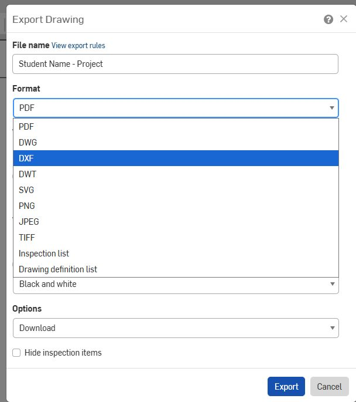
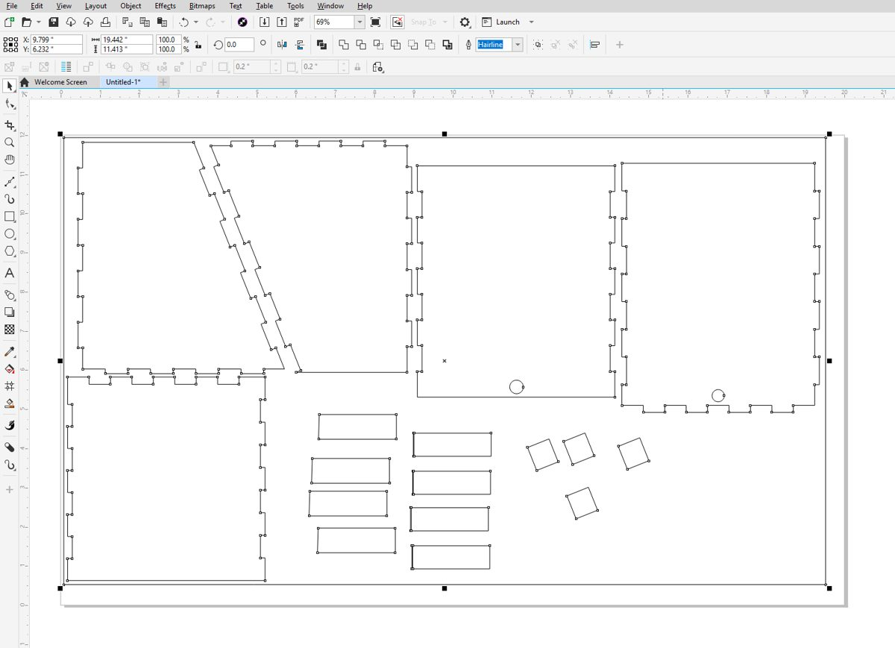
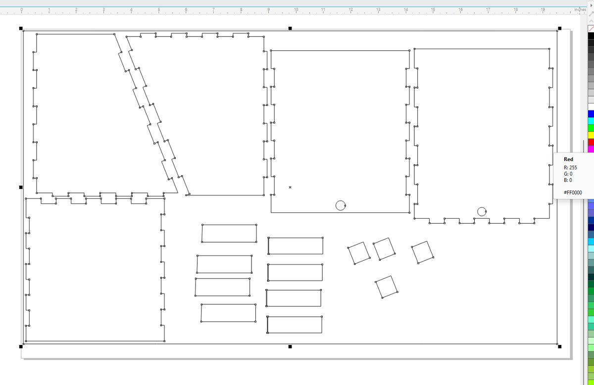
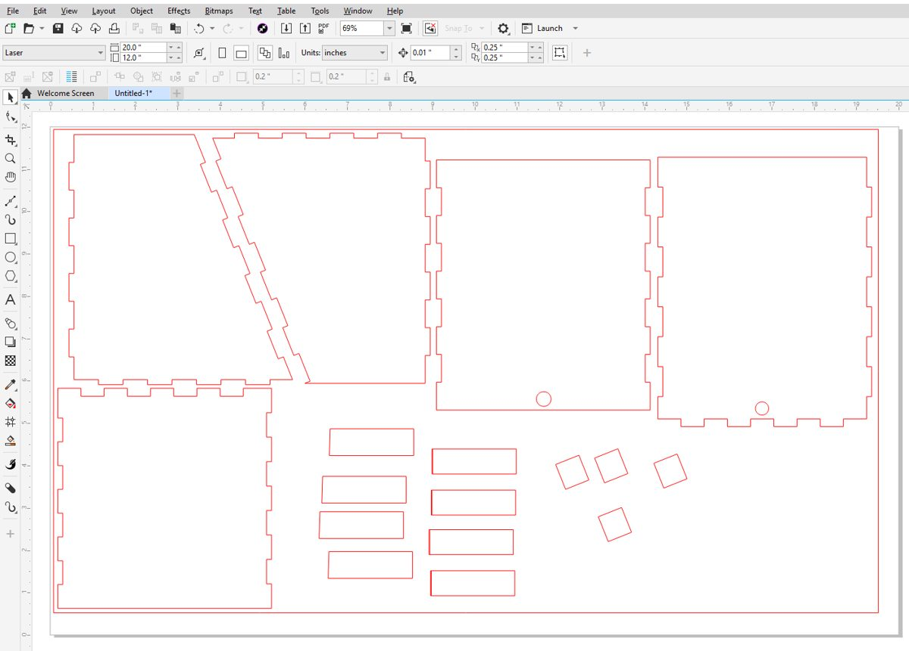

# Laser Cutting: Prepare Your Design

You will be using **Onshape**, **CorelDRAW**, and **Rayjet Manager** to laser cut.

## 1) Export Onshape Drawing as a DXF

1. Open the **Drawing** tab for your part. Make sure it's drawn at **1:1 scale**.
2. Right-click the drawing tab and choose **Export…**
3. File name: **Student Name - Project**
4. Format: **DXF**, then **Export** to download it.

{ width="380" }

!!! warning "Scale must be 1:1"
    If your drawing isn't 1:1, the laser cuts the wrong size. Drawings also export the border, title block and dimensions; you'll delete those in CorelDRAW.

## 2) Open Rayjet Manager

## 3) Open CorelDRAW

## 4) Create new CorelDRAW document

**File → New**

## 5) Set size of CorelDRAW document as the size of your material

Choose a template or a custom size. The maximum is 29" × 17".

## 6) Import downloaded Onshape DXF into the new CorelDRAW document

**File → Import.** Click your part and check that the width and height in the toolbar match your Onshape dimensions.

- [ ] Size matches Onshape
- [ ] Border, title block and dimension lines deleted

## 7) Customize lines to engrave, etch, or cut

Select all necessary lines and change line colors to the process you want: **cut**, **etch**, or **engraving**.

- :red_circle: **Red:** Vector Cut
- :large_blue_circle: **Blue:** Vector Engrave (also called *Etching*, *Marking*, or *Scoring*)
- :black_circle: **Black:** Raster Engrave

**Select All or Select lines to be CUT and *right* click on RED.**

!!! tip
    **Right-click** a color swatch = line (outline) color. **Left-click** = fill color.

## 8) File → Print to send your design to the Rayjet Manager Software

## 9) Go to the Rayjet Manager Software

- [ ] Check the preview: are all your parts there, at the right size?
- [ ] Set the material so the right power and speed load for each color.
- [ ] Send the job to the laser.

!!! note "Instructor: please verify"
    Add our exact Rayjet Manager clicks here.

## Before you press START

- [ ] Ventilation fan is ON
- [ ] Material lies flat on the bed
- [ ] Z calibrated with the calibration tool on **this** material
- [ ] Calibration tool is back in its spot
- [ ] Lid closed, then press **START** on the control panel

!!! danger "Never walk away while it's cutting."

## After the cut

1. **Wait for the smoke to clear** before opening the lid.
2. **Test before moving anything.** Gently press a part. Not cut through? Run it again *without moving the sheet*.
3. **Remove your parts** and clean scraps out of the machine.
4. **Measure your fit** with calipers and compare it to Onshape. Too loose or tight? You just measured the kerf.
