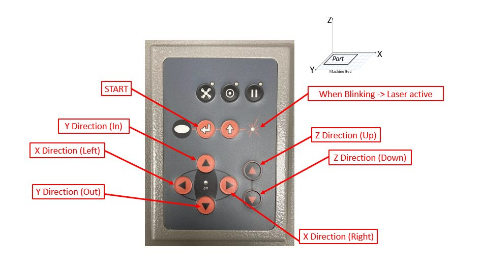
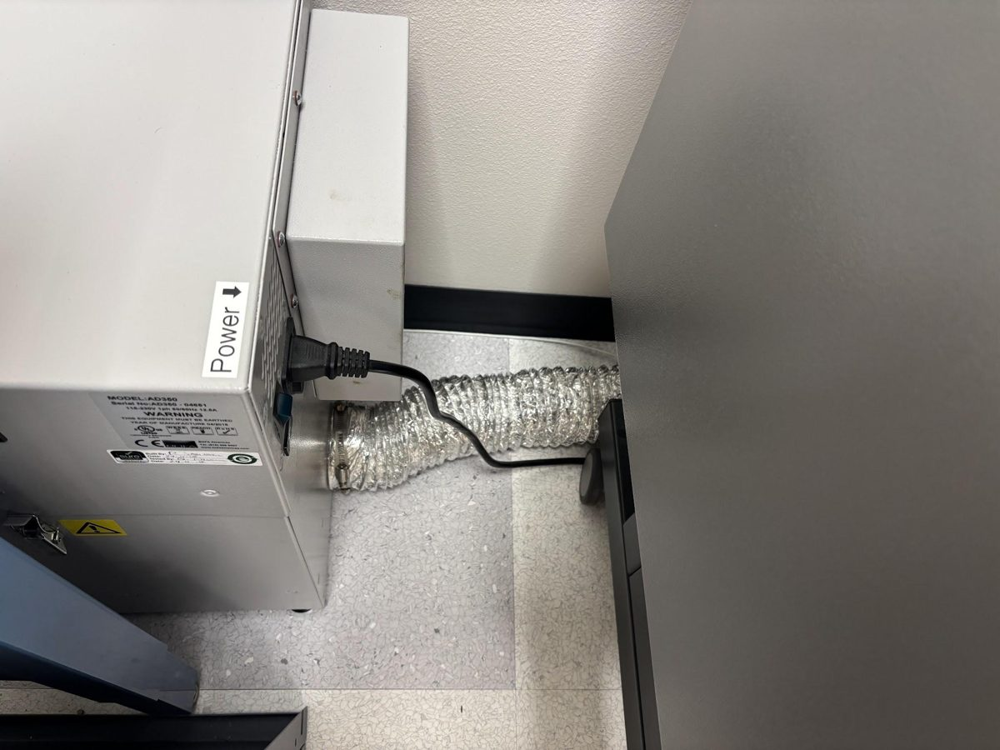
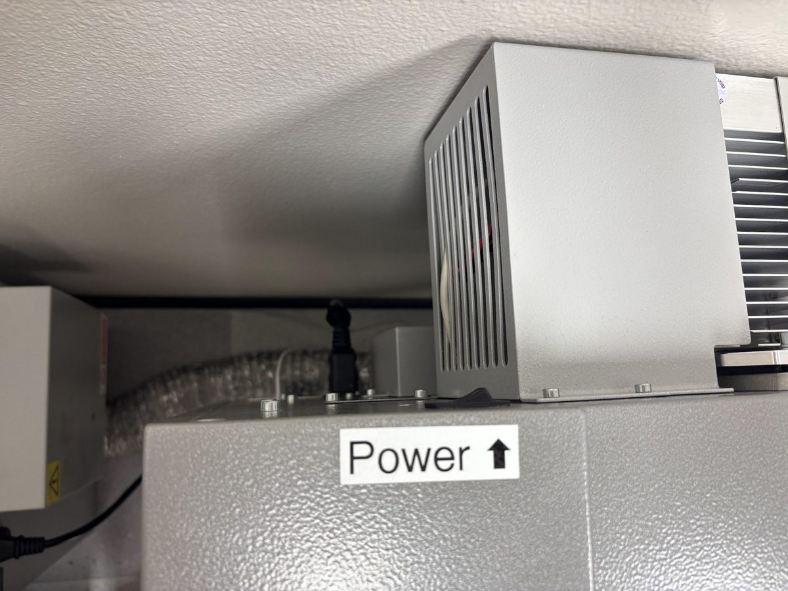
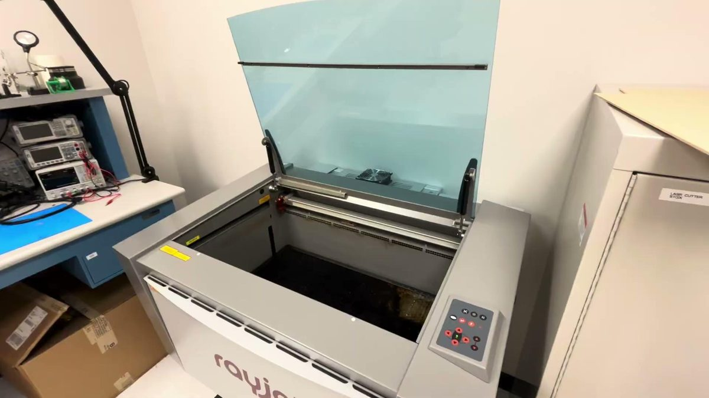
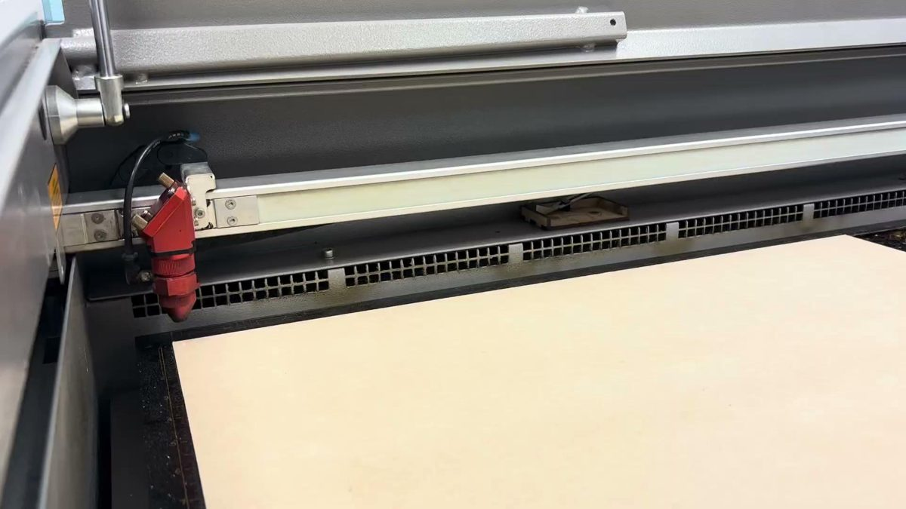
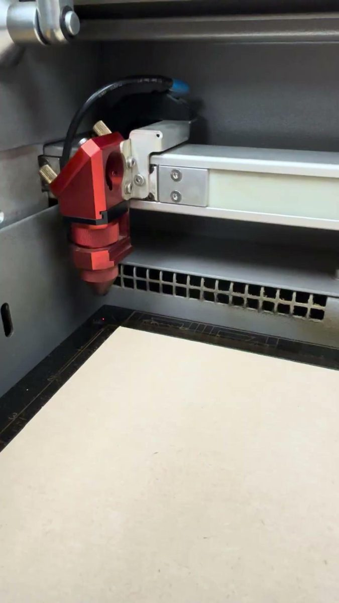

# Laser Cutting: Prepare the Machine

Do these steps in order. Check each box as you go.

## The control panel

On the right side of the machine is a control panel you can use to control positioning of the actual laser.

- **X / Y arrows** move the laser head left/right and in/out.
- **Z arrows** move the **bed** up and down (not the laser head).
- **START** runs the job.
- **Blinking light** means the laser is active.

---

## Step 1: Turn on Ventilation Fan

- [ ] Fan is on

## Step 2: Turn on Laser Cutting Machine

- [ ] Machine is on

## Step 3: Let Machine Startup

- [ ] Lid needs to be closed
- [ ] The machine will lower its bed, then move the laser head
- [ ] The machine will beep 3 times, then do a final beep
- [ ] After the final beep, you can continue to calibrate the machine

!!! info "Hands off until the final beep"
    The machine is finding its home position. Pressing buttons now can confuse it.

## Step 4: Calibrate Machine (Z-direction)

**a. Place material on machine bed.** Make sure it lies flat and fits inside the 29" × 17" bed.

**b. Using the control panel, bring the bed UP (in the z direction) about 1 inch away from your material on the bed.**

!!! danger "DO NOT CRASH LASER INTO BED or MATERIAL"
    Go slowly with the Z arrows and watch the gap the whole time.

**c. Place calibration tool on end of laser.**

**d. Using the control panel, SLOWLY bring the bed up (in z) so that the calibration tool barely meets your material and falls off.**

{ width="300" }

**e. Place calibration tool in its spot on the machine edge once done using.**

!!! tip "Why calibrate?"
    The lens focuses the beam to its smallest, hottest point at one exact distance. Every material is a different thickness, so the bed height has to be set for **every new material**. When the tool tips off, the lens is at the right height.

## Step 5: Position Laser Starting Point

- [ ] Use the **X / Y arrows** to move the laser head over the **top-left corner** of your material.
- [ ] Leave a small margin from the edge.
- [ ] Check that your design fits between this point and the far edges of the sheet.

!!! note "Instructor: please verify"
    Check this step against how we position jobs in Rayjet Manager, and edit as needed.

**Next:** [Prepare Your Design →](prepare-design.md)
