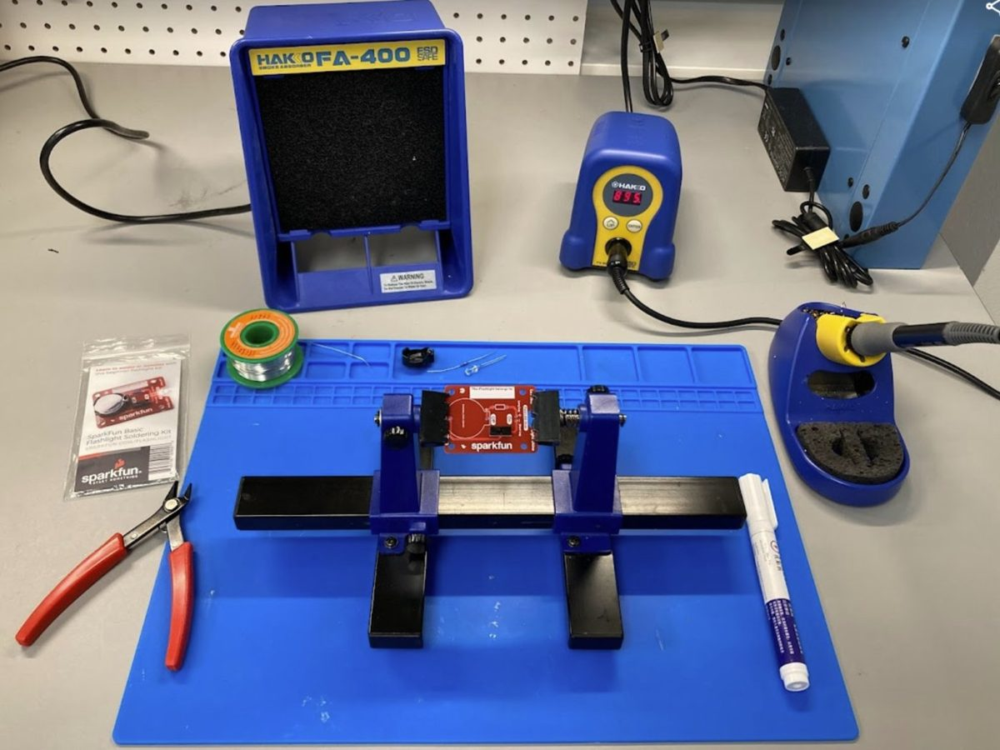
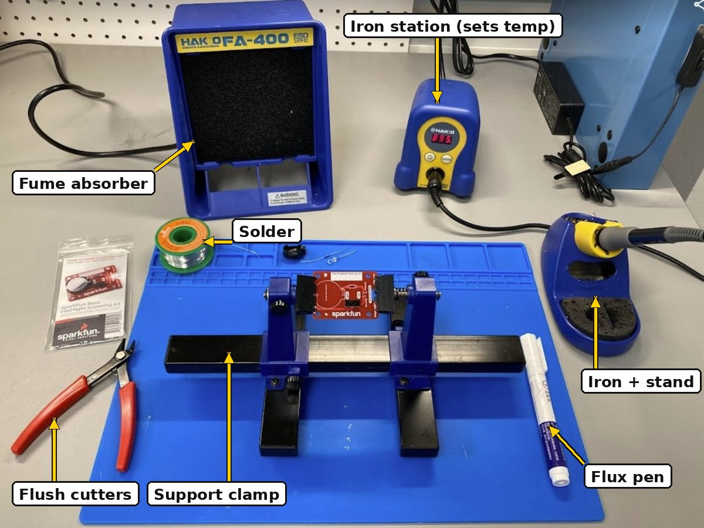

# Soldering: Overview & Safety

[:material-arrow-left: Back to Home](../index.md){ .md-button }

**New to the lab?** Read the [Lab Rules](../lab-rules.md) first. They apply to every machine.

Soldering is a skill commonly used in electronics to connect components and create robust electrical connections. In this **Introduction to Soldering Micro Badge**, you'll learn the key concepts and tools, then build a **SparkFun Basic Flashlight Soldering Kit**.

!!! warning "Before you start"
    - **Where:** soldering stations in **CAS 113** and **CAS 117**
    - **Bring:** your SparkFun Basic Flashlight Soldering Kit
    - **Wear:** safety glasses the whole time

## What is soldering?

Soldering joins metal parts using a lower-melting metal (**solder**) to make a strong electrical connection.

1. **Heat the parts.** The iron heats the pad and the component lead together.
2. **Solder flows.** Melted solder is pulled toward the heat and wraps the joint.
3. **It bonds.** Solder bonds with the copper as it cools. It's not glue!

!!! tip "The golden rule"
    **Heat the joint, not the solder.** If you melt solder onto a cold part, it won't stick.

## The process

Every soldering job follows the same path:

At the soldering station

<ol class="flow__steps">
<li>PrepHeat the iron, wet the sponge, fume absorber on</li>
<li>PrepPrep your wires or parts</li>
<li>Clean & tinClean the tip and coat it with solder</li>
<li>SolderHeat the joint, feed solder, inspect</li>
<li>Shut downTin the tip, unplug, clean up</li>
</ol>

The [Step-by-Step](steps.md) page walks through each step.

## Watch first

▶ Watch: Soldering Crash Course

<iframe src="https://www.youtube-nocookie.com/embed/6rmErwU5E-k" title="Soldering Crash Course" allow="accelerometer; encrypted-media; gyroscope; picture-in-picture" allowfullscreen loading="lazy"></iframe>

Video not playing? <a href="https://www.youtube.com/watch?v=6rmErwU5E-k">Open it on YouTube</a>.

While you watch, notice:

- Where the iron touches the joint
- Which side the solder is fed from
- How long each joint takes
- What a finished joint looks like

## Your station

| Tool | What it does |
|---|---|
| **Soldering iron + stand** | Heated tip melts solder; the iron station sets the temperature |
| **Solder** | Metal alloy wire that forms the bond |
| **Flux** | Cleans oxidation off the metal so solder sticks |
| **Fume absorber** | Filters fumes away from your face |
| **Support equipment** | Holds your work so your hands are free |
| **Wire strippers** | Remove insulation; match the notch to the wire gauge |
| **Flush cutters** | Cut solder and trim component leads |
| **Safety glasses** | Always on while soldering |

*Wire strippers and safety glasses aren't in the photo. You'll find them at your station.*

### Can you find each tool?

Look at the photo above and try to spot each tool from the list. Then check yourself:

## Why clean and shiny matters

Hot metal **oxidizes** within seconds, forming a dark layer that solder won't stick to. **Flux** cleans the joint as you solder, and **tinning** (a thin coat of solder) protects the iron's tip. A dark, crusty tip barely transfers heat; a shiny, tinned tip works well.

## Safety

!!! danger "The tip is several hundred °C"
    The iron always goes back in its stand. **Never catch a falling iron.** Let it drop and step back.

- **Safety glasses at all times.** Solder can spatter, and clipped leads fly.
- **Fume absorber on.** Don't lean over the smoke.
- **Wash your hands after soldering.** No food or drinks at the station.
- **Clear, tidy workspace.** No loose sleeves, cords, or flammable materials near the tip.
- **Turn off and unplug** the iron when you're done.
- **Burned?** Cool running water right away, then tell the instructor.
- Know where the **fire extinguisher** (rated for electrical fires) and the **first aid kit** are.

!!! quiz "Required: Now take the safety quiz in Canvas"
    Done reviewing this page? [Go to Canvas](https://wcc.instructure.com/courses/2771437) and take the **Soldering Badge: Safety Quiz**. You need **100%** to pass, and you can retake it as many times as you need. You must pass it before you use the equipment.

    [:material-open-in-new: Take the quiz in Canvas](https://wcc.instructure.com/courses/2771437){ .md-button }

**Next:** [Step-by-Step →](steps.md)
