# Soldering: Step-by-Step

Review these steps **before** starting the soldering badge activity: the **SparkFun Basic Flashlight Soldering Kit** ([full kit directions](https://learn.sparkfun.com/tutorials/flashlight-kit#how-to-solder)).

**Step 1: Prep your iron → Step 2: Prep wires/parts → Step 3: Clean & tin → Step 4: Solder & inspect**

## Step 1: Prep Your Soldering Iron

- [ ] **A. Plug in your soldering iron** and set it to the right temperature for your project and solder. Make sure the iron is in its stand before turning it on. Not sure of the temperature? Ask your instructor or lab technician.

    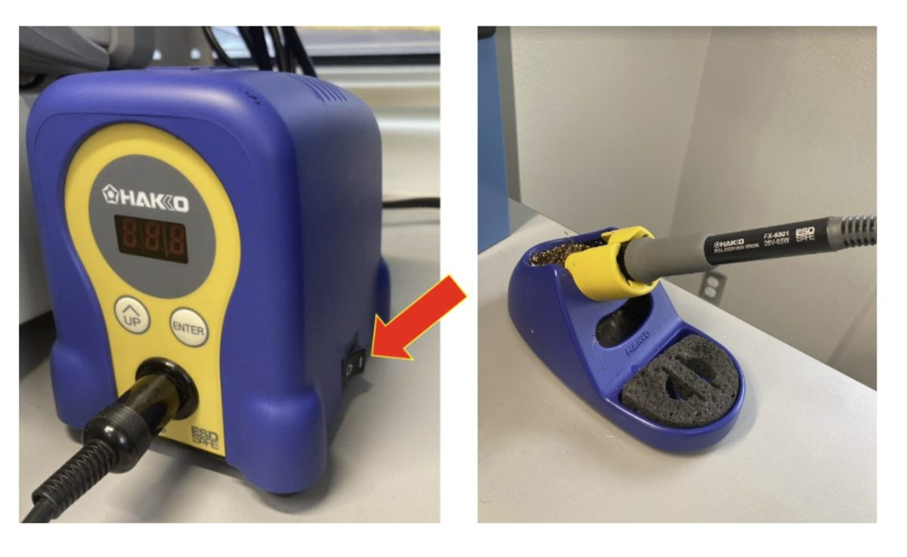

- [ ] **B. Soak the sponge** using the area's water container. It should be damp, not dripping.

    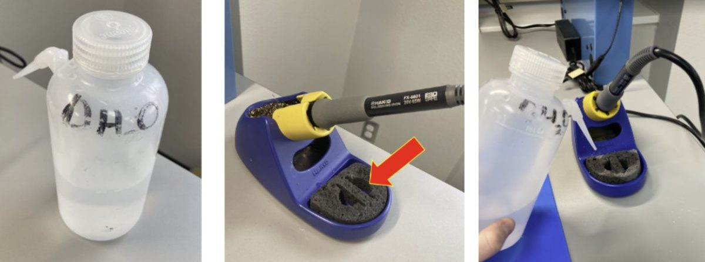

- [ ] **C. Turn on a fume absorber** (the switch is on the back).

    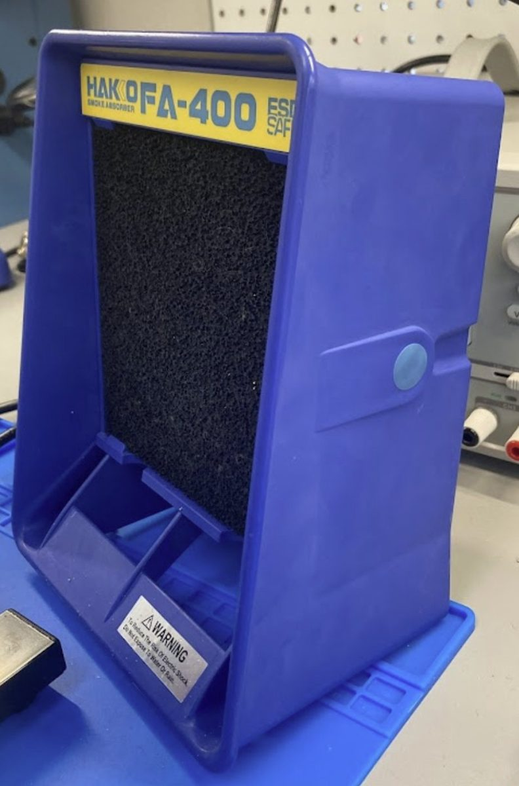{ width="260" }

- [ ] **D. Prep your workspace while the iron heats up.** Gather safety glasses, flux, solder, support equipment, and the wiring or components to be soldered.
- [ ] **E. Secure your project** in support equipment of your choice. Some let you move or rotate the work.

    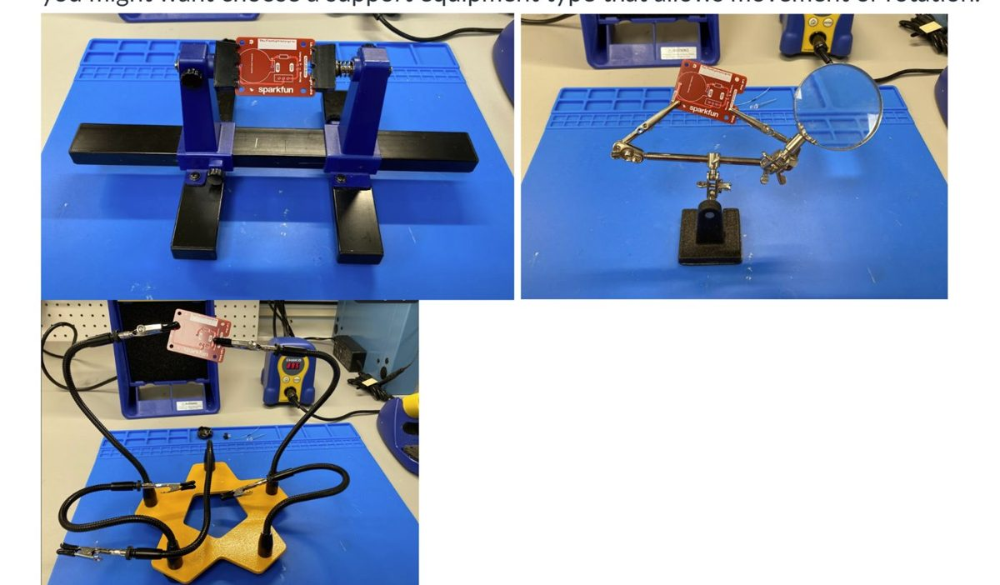

## Step 2: Wire Prep

**A. Strip wires.** Using wire strippers, strip roughly 1/2 inch of insulation from the ends to be soldered.

1. Find the wire's gauge by comparing it to the guide on the side of the stripper.
2. Place the wire in the notch for that gauge.
3. Close the strippers so they cut through the coating.
4. With the jaws still closed, pull the coating off the end of the wire.

**B. Join wires.** Position the wires in your support equipment and twist the exposed strands together.

**C. Flux.** Apply a small amount of flux to the areas to be soldered.

!!! note "Flashlight kit"
    For the flashlight kit, you don't need to prep wires beyond removing the protective paper ends.

    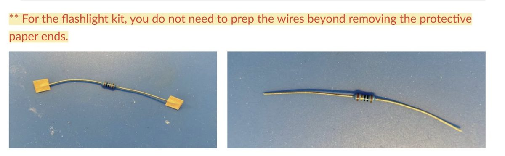

## Step 3: Tinning

**Tinning** is coating the iron's tip with a thin layer of solder. It stops the tip from oxidizing and helps heat move into your joint.

- [ ] **A. Check the tip.** Dark and crusty = oxidized. Shiny silver = ready. Not sure? Ask!
- [ ] **B. Clean.** Once the iron is hot, wipe the tip on the damp sponge and/or brass wire cleaner until it's shiny.
- [ ] **C. Tin.** Melt a small amount of solder onto the tip so it has a thin, even, shiny coat.

!!! tip
    Tin before and after each session, and as you go on long jobs. Tips last much longer when you do.

## Step 4: Solder

[▶ Watch this video first (YouTube)](http://www.youtube.com/watch?v=f95i88OSWB4)

**A. Cut yourself a piece of solder.** A short piece is easier to control than the spool.

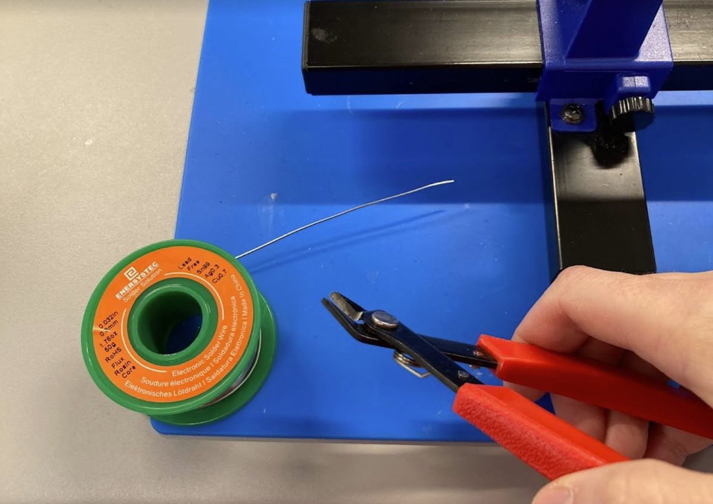

**B. Insert the component.** Put the leads through the holes and bend them slightly to hold the part. Check which way it goes first! LEDs have a long leg (+) and a short leg (−).

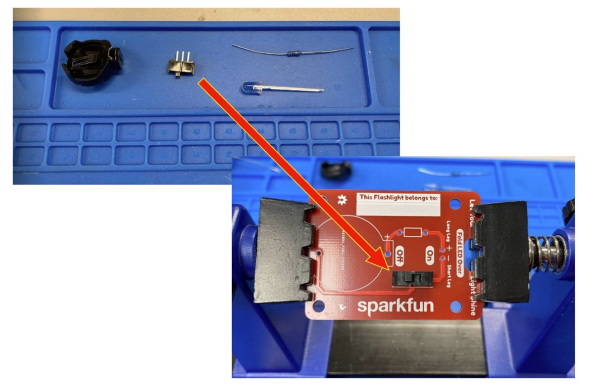

**C. Apply flux to the joint.**

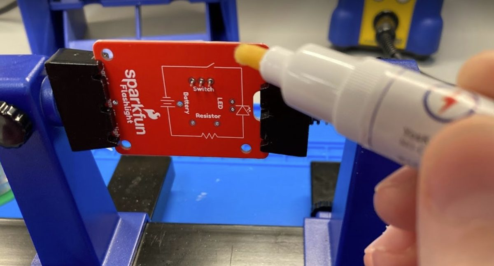

**D. Solder.**

| # | Do this | Time |
|---|---|---|
| 1 | **Heat:** touch the tip to the pad **and** the lead at the same time | 1–2 s |
| 2 | **Feed:** touch solder to the joint (opposite the iron, not on the tip) | 1–2 s |
| 3 | **Remove the solder** once it flows around the lead | |
| 4 | **Remove the iron** | |
| 5 | **Hold still** while it cools | 2–3 s |

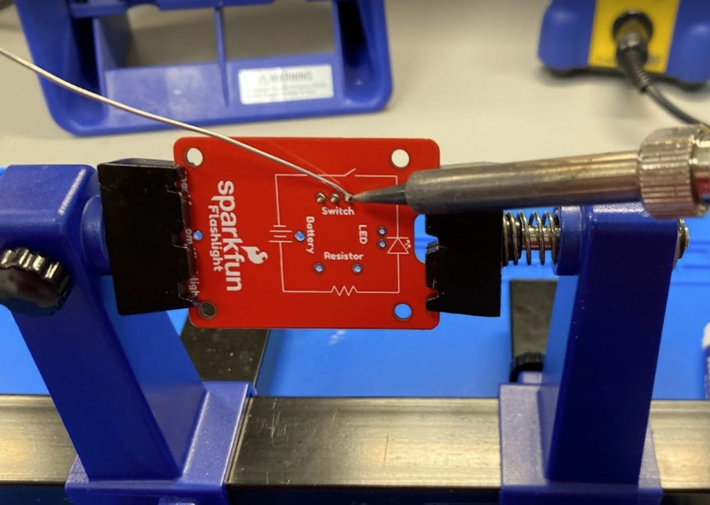

!!! warning "About 3–5 seconds per joint"
    Holding the iron on much longer can lift the copper pad off the board.

**E. Inspect.** The joint should be shiny, smooth, and securely bonded. See [Good vs. Bad Joints](joints.md).

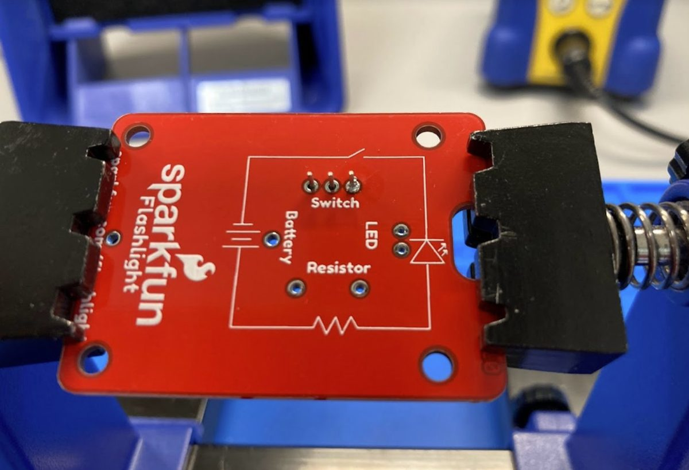

**F. Trim and repeat as needed.** Trim leads just above the joint with flush cutters, wearing safety glasses.

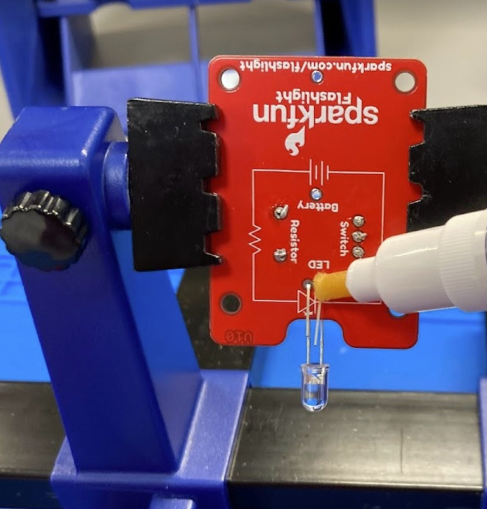

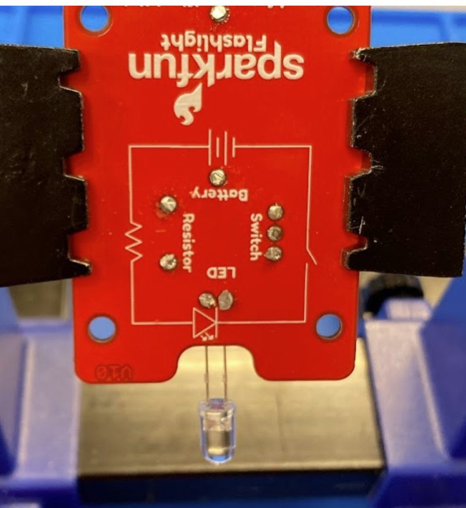

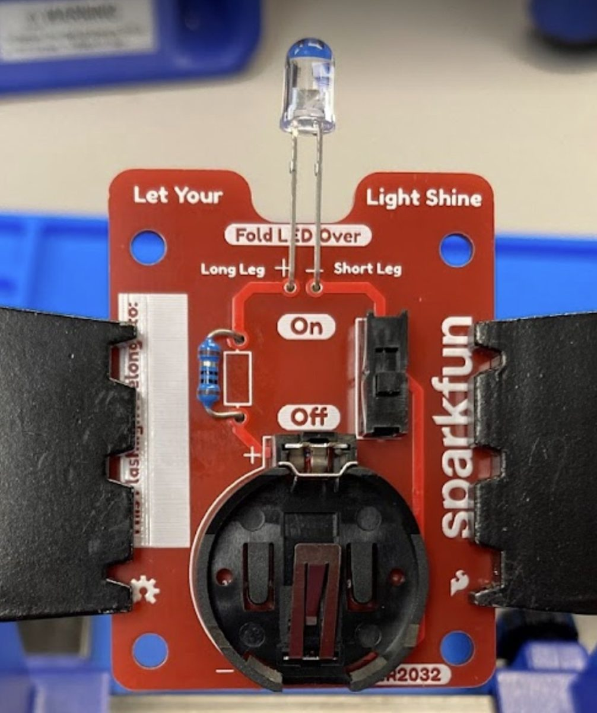

## Shut down your station

- [ ] Tin the tip
- [ ] Iron off and unplugged, back in the stand to cool
- [ ] Fume absorber off
- [ ] Clean up clipped leads and solder bits; put tools back
- [ ] Wash your hands
